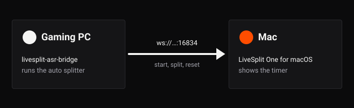

# LiveSplit One for macOS

An unofficial native macOS version of LiveSplit One, the speedrun timer. It isn't made by the LiveSplit team, and it is a version of LiveSplit One, not of the original Windows LiveSplit.

It behaves like the classic LiveSplit: one window showing only the timer, with everything else in a right-click menu. It reads and writes the same splits and layout files as LiveSplit One, and draws layouts with the same renderer, so a layout looks the same as in LiveSplit One.

It is made for two-PC setups: a gaming PC runs the game and [livesplit-asr-bridge](https://github.com/alexcosta97/livesplit-asr-bridge), and a Mac shows the timer.

## Start here

1. [Installing](Installing): download the app and open it the first time.
2. [Getting Started](Getting-Started): open splits and a layout, run an attempt, save, and connect to livesplit-asr-bridge.

## More

- [The Timer Window](The-Timer-Window): moving and resizing the window, Always on Top, keyboard shortcuts, and the notices it shows.
- [The Menu](The-Menu): every command in the right-click menu and the menu bar.
- [Splits and Layouts](Splits-and-Layouts): opening and saving splits and layouts, unsaved changes, and what reopens at launch.
- [Connecting to a Server](Connecting-to-a-Server): taking timer commands from livesplit-asr-bridge on another computer.
- [Settings and Logs](Settings-and-Logs): where the app keeps its settings and logs.
- [Troubleshooting](Troubleshooting): what you see, why, and what to do.
- [Upcoming Changes](Upcoming-Changes): documentation for changes not yet released.
